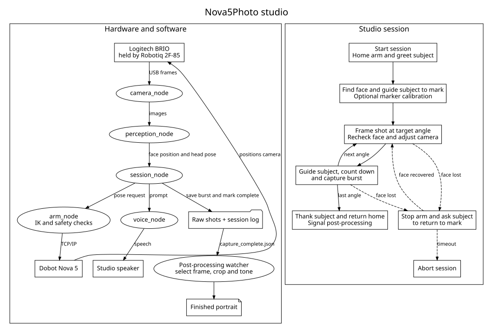

# Nova5Photo

Nova5Photo is a ROS 2 portrait studio. A Dobot Nova 5 positions a Logitech BRIO held in a Robotiq 2F-85 gripper. The studio tracks the sitter’s face, gives spoken direction, and captures full-resolution stills from several angles. A separate Python process selects a frame and produces a 4:5 portrait.



## Build the workspace

On the Ubuntu 22.04 studio machine, build with ROS 2 Humble in a system Python shell.

```bash
cd ~/Nova5Photo
source /opt/ros/humble/setup.bash
colcon build --symlink-install
source install/setup.bash
```

In each additional ROS terminal, source both setup files from the repository root. The image processor uses its own Python environment. To create it on the lab machine:

```bash
python3 -m venv .venv
.venv/bin/pip install torch==2.5.1 torchvision==0.20.1 --index-url https://download.pytorch.org/whl/cu121
.venv/bin/pip install "numpy<2" transformers==4.46.3 mediapipe==0.10.14 opencv-contrib-python-headless==4.10.0.84 pillow pyyaml
.venv/bin/pip install -e postprocess --no-deps
```

## Voice options

Set `voice:=espeak-ng` for lightweight offline speech (install the Ubuntu `espeak-ng` package), or `voice:=none` for silent operation. Both modes work with the regular ROS installation. The default, `voice:=neural`, uses Piper for English and Swedish and Kokoro for Mandarin. The configured voices are in [portrait.yaml](src/portrait_bringup/config/portrait.yaml).

The neural server runs as a separate process. By default it uses `.venv-tts/bin/python` to isolate its machine-learning dependencies. To share the project’s existing Python 3.10 environment, run the following from the workspace root before launching ROS:

```bash
export PORTRAIT_TTS_PYTHON="$PWD/.venv/bin/python"
"$PORTRAIT_TTS_PYTHON" -m pip install piper-tts kokoro "misaki[zh]" soundfile pyyaml
"$PORTRAIT_TTS_PYTHON" -m pip check
```

This setting selects the interpreter for speech only. Keep the ROS shell sourced as above. If the shared environment reports dependency conflicts, use the separate TTS environment. Kokoro may download voice assets on first use.

**Optional Mandarin Piper model.** If you configure a Piper voice that uses g2pW for Chinese pronunciation, download the [Piper g2pW archive](https://huggingface.co/datasets/rhasspy/piper-checkpoints/resolve/main/zh/zh_CN/_resources/g2pw.tar.gz?download=true) and extract its contents into `g2pW/` at the workspace root. Check that `g2pW/g2pw.onnx` exists. This local model directory is excluded from Git.

## Run in simulation

Simulation is the default launch mode and uses the lab’s Isaac Sim environment. This example starts a session automatically and records it to `/tmp/nova5-sim/sim_run.mp4`. The separate ROS domain keeps simulation traffic isolated from the studio.

```bash
ROS_DOMAIN_ID=42 ros2 launch portrait_bringup portrait.launch.py \
  name:="Sim Tester" headless:=true record:=/tmp/nova5-sim
```

## Run the studio

**When the seat or camera geometry changes**, recalibrate before a real session. With the launch stopped, secure the camera, aim it at the seat, release DobotStudio Pro’s controller connection, and run `scripts/calibrate_layout.py --style natural` (or `professional`). Follow the AprilTag cube prompts. The script writes the measured poses to [layout/current.yaml](layout/current.yaml). Validate the layout in simulation and keep everyone outside the arm’s reach for its first real move.

**For a calibrated studio**, keep the pendant e-stop within reach. Check the camera grip and controller kinematics before launching. Use the studio’s controller address and USB video device if they differ from the values below.

```bash
ros2 node list                         # check for an existing studio launch
scripts/gripper.py status              # expect HOLDING OBJECT
ros2 run portrait_arm check_robot --ip 192.168.0.37
ros2 launch portrait_bringup portrait.launch.py mode:=real robot_ip:=192.168.0.37 camera:=/dev/video0
```

Leave the launch running. In a second terminal, start the image processor once for the day’s sessions:

```bash
scripts/run_postprocess.sh
```

In a third terminal, start one session per sitter. Spoken guidance supports English (`en`), Swedish (`sv`), and Chinese (`zh`).

```bash
ros2 run portrait_session start --name "Ada Lovelace" --language en
```

The arm returns home, finds the face, and guides the sitter into position. An optional marker measurement refines the distance estimate. At each configured angle the studio frames the face, gives a cue, counts down, and captures a burst. If tracking is lost during capture, the session pauses for the sitter to return and aborts on timeout.

## Output and monitoring

Capture writes the original stills and `session.json` under `portraits/<name>/<stamp>_raw/`. When it writes `capture_complete.json`, the image processor selects a frame, applies the layout’s natural or professional look, and saves `portraits/<name>/<stamp>.jpg`. The natural look adds a vivid colour grade; the professional look is ungraded. Around the head the background blur fades in gradually so hair keeps its edge. The default output is 1200 × 1500 pixels.

```bash
ros2 topic echo /portrait/session_state
ros2 run rqt_image_view rqt_image_view /portrait/debug_image
```

To stop arm motion, call `ros2 service call /arm/stop std_srvs/srv/Trigger`. To end the session, call `ros2 service call /portrait/abort std_srvs/srv/Trigger`. At shutdown, stop the studio software with `scripts/lab_stop.sh` and support or remove the camera before cutting gripper power.

## Code and configuration

- [ROS packages](src/) implement motion and safety checks, camera capture, face tracking, speech, and session control.
- [Studio defaults](src/portrait_bringup/config/portrait.yaml) configure the nodes. The [launch file](src/portrait_bringup/launch/portrait.launch.py) applies the selected layout and connects the real or simulated hardware.
- [Simulation](sim/) contains the Isaac Sim scene and launcher.
- [Post-processing](postprocess/) contains frame selection, depth-based background blur, tone, and cropping.
- [Studio scripts](scripts/) cover calibration, gripper checks, voice service, and process management.
